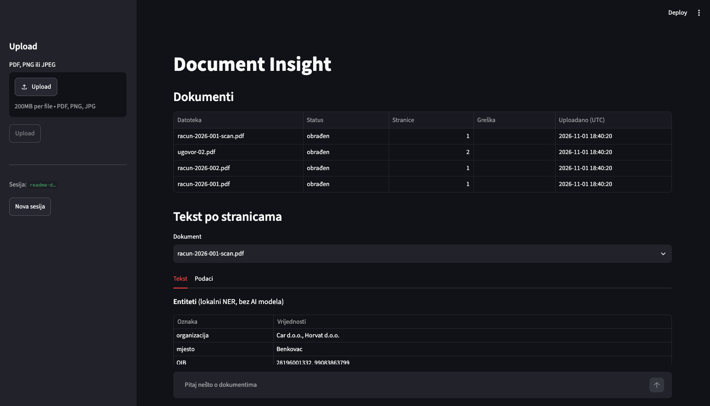
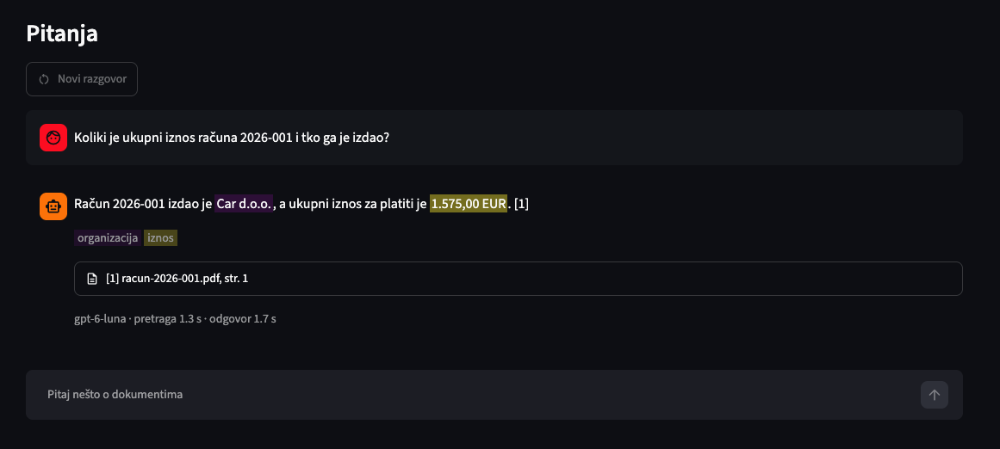
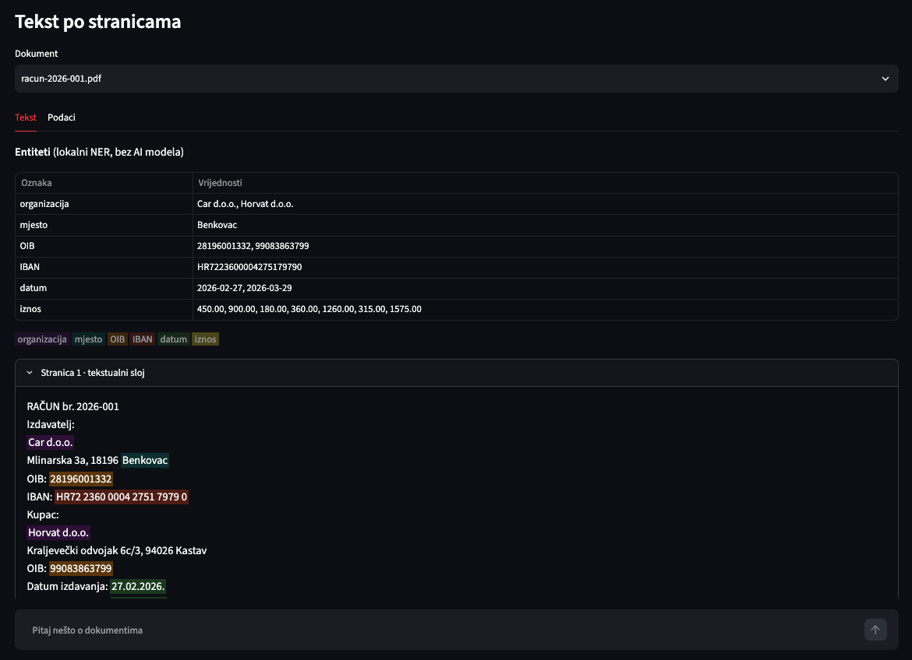
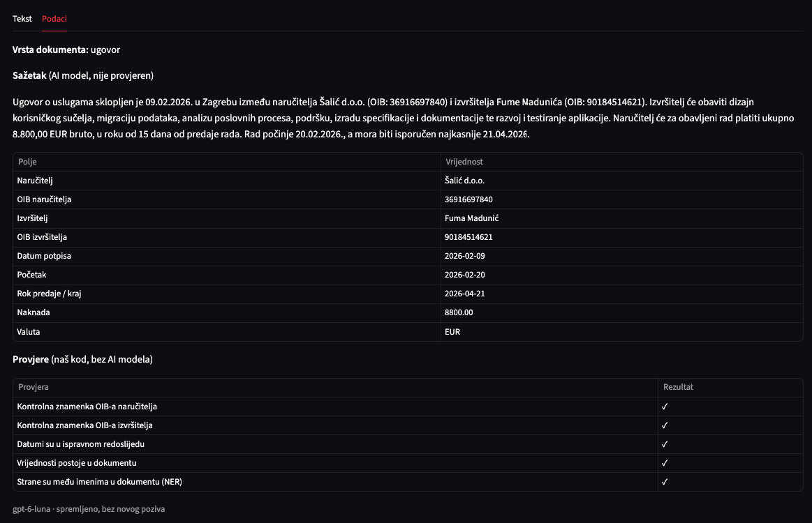
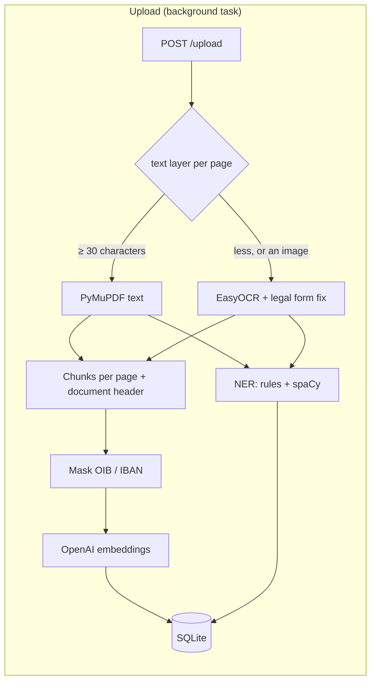
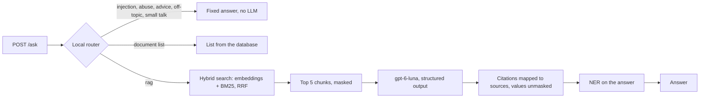
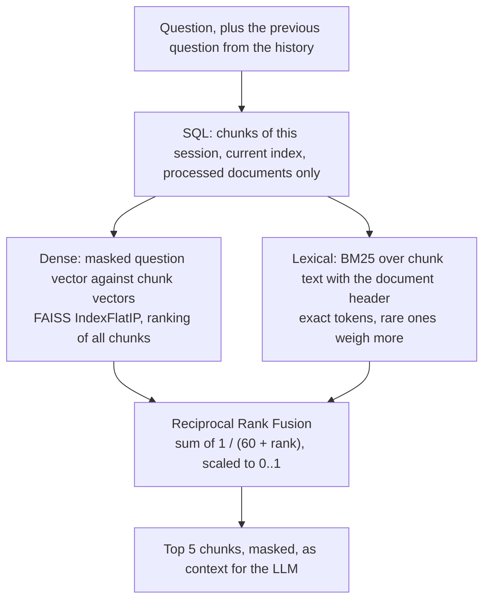
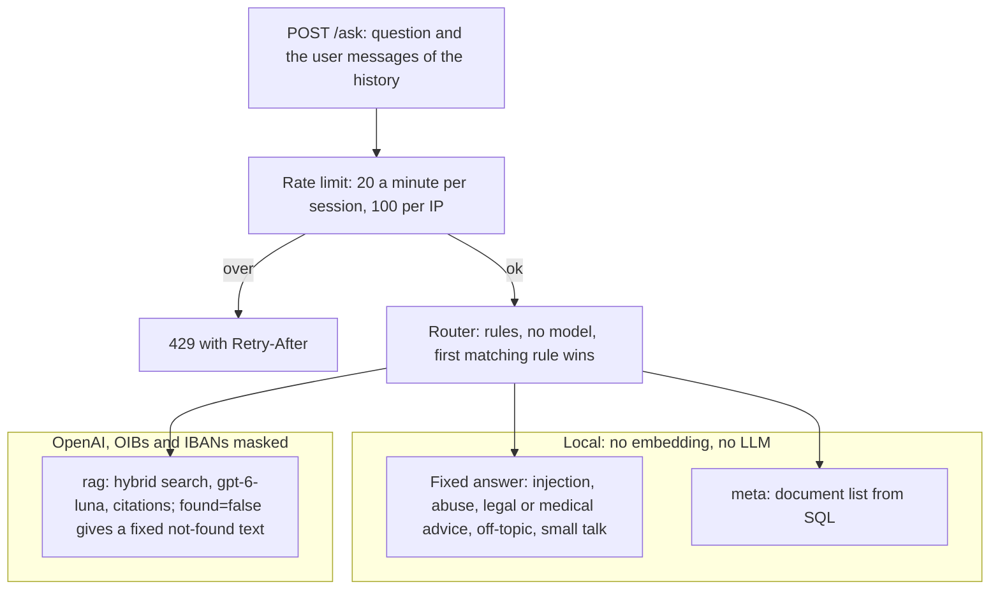

# Document Insight Service

A FastAPI service that reads invoices and contracts (PDF or scanned images), answers questions about them with citations to file and page, and extracts their fields into checked JSON.

- **Upload PDF, PNG and JPEG.** The text layer of a PDF is used where it exists. Scanned pages go through OCR (EasyOCR), page by page.
- **Ask questions in Croatian or English.** Answers come only from your documents and cite file and page. When the answer is not in them, the service says so instead of guessing.
- **Hybrid retrieval.** OpenAI embeddings are fused with BM25 keyword search, so invoice numbers and OIBs are found as reliably as paraphrases.
- **Named entities.** People, places, companies, OIBs, IBANs, dates and amounts are highlighted in answers and in page text (spaCy plus rules with check digits).
- **Document fields as JSON.** Type, summary and invoice or contract fields come from one LLM call with structured output, and our code checks them (check digits, sums, date order, presence in the document).
- **Privacy and cost control.** OIBs and IBANs are masked before every call to OpenAI. A local router answers or refuses off-topic questions and prompt injection attempts without calling the model. Rate limits per session and per IP protect the routes that cost money.
- **Streamlit UI** for uploading, reading and chatting, as a separate service.



| Chat with sources and entities | Page text with entities                        | Fields and checks                 |
| ------------------------------ | ---------------------------------------------- | --------------------------------- |
|   |  |  |

All sample documents in `sample_docs/` are invented. `scripts/generate_sample_docs.py` creates them with Faker and a fixed seed, so every run produces the same files. Their OIBs and IBANs are random, but they have valid check digits.

## Contents

- [Quick start (Docker)](#quick-start-docker)
- [Manual installation](#manual-installation)
- [Configuration](#configuration)
- [API](#api)
- [How it works](#how-it-works)
- [Key decisions](#key-decisions)
- [Evaluation](#evaluation)
- [Privacy and security](#privacy-and-security)
- [How AI-generated code was validated](#how-ai-generated-code-was-validated)
- [Testing and quality](#testing-and-quality)
- [Project structure](#project-structure)
- [Limitations and future work](#limitations-and-future-work)

## Quick start (Docker)

Requirements: Docker with Compose, and an OpenAI API key.

```bash
git clone https://github.com/dino110/ai-document-insight-service.git
cd ai-document-insight-service
cp .env.example .env
```

Open `.env` and put your key after `DOCINSIGHT_OPENAI_API_KEY=`, then start everything:

```bash
docker compose up --build
```

`.env` is ignored by git and by the Docker build, so the key never ends up in a commit or an image. Compose passes it to the API container at start. Instead of editing `.env`, you can also pass the key for one run: `DOCINSIGHT_OPENAI_API_KEY=sk-... docker compose up --build`. A variable set in the shell takes precedence over `.env`.

- **UI:** http://localhost:8501
- **API docs (Swagger):** http://localhost:8000/docs

Notes:

- **First build.** It downloads the CPU-only PyTorch wheels and the EasyOCR and spaCy models. Without cache it took 282 s on an Intel Mac whose Python base image was already pulled. After `up`, the API was healthy in about 30 s, while the OCR and NER models loaded. The UI starts once the API's healthcheck passes.
- **Without an API key.** Upload, OCR, NER and search still work: embeddings fall back to a local hashing embedder. `/ask` and `/documents/{id}/fields` return 503.
- **Taken ports.** Use `API_PORT=8001 docker compose up` or `UI_PORT=8502 docker compose up`.
- **Data.** The SQLite database and the uploaded files live in `./data`, which is mounted into the container and survives rebuilds.
- **Reindexing.** After a change of the embedding model or the chunk format, rebuild the index from stored text (no OCR): `docker compose exec api python -m docinsight.reindex`.
- **Slow tests.** The tests with the real OCR model run in their own image: `docker compose run --rm test`.

## Manual installation

Requirements: Python 3.12 and [uv](https://docs.astral.sh/uv/).

```bash
git clone https://github.com/dino110/ai-document-insight-service.git
cd ai-document-insight-service
cp .env.example .env                           # then set DOCINSIGHT_OPENAI_API_KEY in .env
uv sync                                        # API, dev tools and UI packages
uv run uvicorn docinsight.main:app --reload    # API on http://127.0.0.1:8000
uv run streamlit run ui/app.py                 # UI on http://localhost:8501, in a second terminal
```

- **No OCR outside Docker.** EasyOCR needs PyTorch, which only installs in the Linux image (decision 010; PyTorch has no Intel macOS wheel for the versions EasyOCR needs). Digital PDFs work. Scanned pages and images end as `failed` with "OCR is not available, so scanned pages cannot be read."
- **First start.** On a fresh environment the API can take up to a minute to start, while the spaCy models load for the first time.
- **Other ports.** Run the API on another port with `--port 8010`, and point the UI at it: `API_URL=http://localhost:8010 uv run streamlit run ui/app.py --server.port 8511`.
- **Reindexing:** `uv run python -m docinsight.reindex`.
- **Sample documents** can be regenerated with `uv run python scripts/generate_sample_docs.py`.

## Configuration

Every setting is an environment variable with the prefix `DOCINSIGHT_`, read from `.env`. Every one is optional. The full list with comments is in [`.env.example`](.env.example).

| Variable                                  | Default                                  | Meaning                                                                                                           |
| ----------------------------------------- | ---------------------------------------- | ----------------------------------------------------------------------------------------------------------------- |
| `OPENAI_API_KEY`                          | empty                                    | Embeddings, answers and fields. Without it: hashing embeddings, and 503 from `/ask` and `/fields`.                |
| `LLM_MODEL`, `LLM_REASONING_EFFORT`       | `gpt-6-luna`, `low`                      | Model for answers and fields. `LLM_BASE_URL` points to any OpenAI-compatible server (e.g. Ollama).                |
| `EMBEDDING_BACKEND`, `EMBEDDING_MODEL`    | `auto`, `text-embedding-3-small`         | `auto` uses OpenAI when a key is set and hashing otherwise.                                                       |
| `RETRIEVAL_MODE`                          | `hybrid`                                 | `hybrid` (embeddings + BM25) or `dense`.                                                                          |
| `TOP_K`, `CHUNK_SIZE`, `CHUNK_OVERLAP`    | `5`, `800`, `150`                        | Chunks sent to the LLM, and chunk size and overlap in characters.                                                 |
| `OCR_ENABLED`, `OCR_MIN_CHARS`, `OCR_DPI` | `false` (`true` in compose), `30`, `200` | A PDF page with fewer characters in its text layer goes through OCR.                                              |
| `NER_BACKEND`                             | `auto`                                   | `auto` (spaCy + rules, or rules if the models are missing), `spacy` or `rules`.                                   |
| `MAX_UPLOAD_MB`, `MAX_FILES_PER_REQUEST`  | `20`, `10`                               | Upload limits.                                                                                                    |
| `FIELDS_MAX_CHARS`                        | `12000`                                  | The most document text sent to the LLM for fields.                                                                |
| `RATE_LIMIT_{LLM,UPLOAD,IP}_PER_MINUTE`   | `20`, `10`, `100`                        | Requests a minute: `/ask` and `/fields` (LLM) and `/upload` per session, all three per IP. `0` turns a limit off. |

Compose also reads `API_PORT` and `UI_PORT`. The UI reads `API_URL`.

## API

Documents belong to a session, identified by the `X-Session-ID` header (`[A-Za-z0-9_-]{1,64}`). `POST /upload` creates a new one if the header is missing and returns it. Authentication (JWT) is future work; see [Privacy and security](#privacy-and-security).

`/ask` and `/documents/{id}/fields` share a budget of 20 requests a minute per session, `/upload` allows 10, and one client IP gets 100 a minute across the three. Over a limit the API answers 429 with a `Retry-After` header. Reads are not limited.

| Method | Path                     | What it does                                                                           | Statuses                          |
| ------ | ------------------------ | -------------------------------------------------------------------------------------- | --------------------------------- |
| GET    | `/health`                | Liveness and version.                                                                  | 200                               |
| POST   | `/upload`                | Store up to 10 files, process them in the background.                                  | 201, 400, 413, 415, 422, 429      |
| GET    | `/documents`             | The session's documents with their status.                                             | 200, 422                          |
| GET    | `/documents/{id}`        | Text, extraction method and entities of every page, plus an entity summary.            | 200, 404, 422                     |
| GET    | `/documents/{id}/fields` | Type, summary, invoice or contract fields and checks (LLM on first call, then stored). | 200, 404, 409, 429, 502, 503, 422 |
| POST   | `/ask`                   | Answer a question from the session's documents, with sources and entities.             | 200, 409, 429, 502, 503, 422      |

The examples below are real responses from the Docker setup, shortened with `…`. They use these variables:

```bash
API=http://localhost:8000
SID=readme-demo
```

### Health

```bash
curl -s $API/health
```

```json
{ "status": "ok", "version": "0.1.0" }
```

### Upload

```bash
curl -s -X POST $API/upload -H "X-Session-ID: $SID" \
  -F "files=@sample_docs/racun-2026-001.pdf" \
  -F "files=@sample_docs/racun-2026-002.pdf" \
  -F "files=@sample_docs/ugovor-02.pdf" \
  -F "files=@sample_docs/racun-2026-001-scan.pdf"
```

```json
{
  "session_id": "readme-demo",
  "documents": [
    {"id": "139c28b019e4498680d5b22a5ce1ade6", "filename": "racun-2026-001.pdf", "status": "pending", "page_count": null, …},
    …
  ]
}
```

Processing runs after the response. In Docker, digital PDFs took 0.4 to 2 s and the one-page scan 42 s (EasyOCR on CPU). Poll the list until nothing is `pending`:

```bash
curl -s $API/documents -H "X-Session-ID: $SID"
```

```json
[
  {"id": "ae085b6a2b0e421c88dda0845a2bbd0b", "filename": "racun-2026-001-scan.pdf", "status": "processed", "page_count": 1, "error": null, …},
  {"id": "b6578a50f92547c98117f1ffa976b982", "filename": "ugovor-02.pdf", "status": "processed", "page_count": 2, "error": null, …},
  …
]
```

### Document text and entities

The next examples need the id of `racun-2026-001.pdf` from that list. Copy it by hand, or read it with [jq](https://jqlang.org/):

```bash
ID=$(curl -s $API/documents -H "X-Session-ID: $SID" \
  | jq -r 'first(.[] | select(.filename == "racun-2026-001.pdf")) | .id')
curl -s $API/documents/$ID -H "X-Session-ID: $SID"
```

```json
{
  "filename": "racun-2026-001.pdf",
  "status": "processed",
  "pages": [
    {
      "page_number": 1,
      "method": "text_layer",
      "text": "RAČUN br. 2026-001\nIzdavatelj:\nCar d.o.o.\n…",
      "entities": [
        {"text": "Car d.o.o.", "label": "ORG", "normalized": "Car d.o.o.", "start": 31, "end": 41},
        {"text": "28196001332", "label": "OIB", "normalized": "28196001332", "start": 76, "end": 87},
        …
      ]
    }
  ],
  "entity_summary": {"ORG": ["Car d.o.o.", "Horvat d.o.o."], "OIB": ["28196001332", "99083863799"], "MONEY": [… "1575.00"], …}
}
```

For a scan, `method` is `"ocr"`.

### Ask

```bash
curl -s -X POST $API/ask -H "X-Session-ID: $SID" -H "Content-Type: application/json" \
  -d '{"question": "Koliki je ukupni iznos računa 2026-001 i tko ga je izdao?"}'
```

```json
{
  "answer": "Ukupni iznos računa 2026-001 je 1.575,00 EUR, a izdao ga je Car d.o.o. [1]",
  "found": true,
  "sources": [{"filename": "racun-2026-001.pdf", "page_number": 1, "snippet": "RAČUN br. 2026-001\nIzdavatelj:\nCar d.o.o.\n…", "score": 1.0, …}],
  "route": "rag",
  "model": "gpt-6-luna",
  "timings_ms": {"retrieval": 329.6, "generation": 4453.2, "ner": 8.5},
  "entities": [
    {"text": "1.575,00 EUR", "label": "MONEY", "start": 32, "end": 44},
    {"text": "Car d.o.o.", "label": "ORG", "start": 60, "end": 70}
  ]
}
```

`[1]` points at `sources[0]`. Entity offsets point into `answer`.

### A follow-up question with history

The client sends the earlier conversation, at most 6 messages. The server stores none of it.

```bash
curl -s -X POST $API/ask -H "X-Session-ID: $SID" -H "Content-Type: application/json" \
  -d '{"question": "A PDV?", "history": [
        {"role": "user", "text": "Koliki je ukupni iznos računa 2026-002?"},
        {"role": "assistant", "text": "Ukupni iznos računa 2026-002 je 9.537,50 EUR."}]}'
```

```json
{
  "answer": "PDV na računu 2026-002 iznosi 1.907,50 EUR. [1]",
  "found": true,
  "sources": [{"filename": "racun-2026-002.pdf", "page_number": 1, "score": 0.9919, …}],
  "route": "rag",
  "timings_ms": {"retrieval": 290.6, "generation": 1796.2, "ner": 7.1},
  …
}
```

Without the history, "A PDV?" gets the VAT of every invoice.

### A question the router answers without the LLM

```bash
curl -s -X POST $API/ask -H "X-Session-ID: $SID" -H "Content-Type: application/json" \
  -d '{"question": "Trebam li tužiti dobavljača?"}'
```

```json
{
  "answer": "Ne dajem pravne savjete. Mogu ti reći što piše u tvojim dokumentima (rokovi, iznosi, nadležni sud), a za savjet se obrati odvjetniku.",
  "found": false,
  "sources": [],
  "route": "legal_advice",
  "model": null,
  "timings_ms": {},
  "entities": []
}
```

It took 60 ms, and the question never left the service. Other routes are `rejected_injection`, `rejected_abuse`, `out_of_scope`, `smalltalk` and `meta` (the document list).

### Document fields

```bash
curl -s $API/documents/$ID/fields -H "X-Session-ID: $SID"
```

```json
{
  "document_type": "invoice",
  "summary": "Račun br. 2026-001 izdalo je društvo Car d.o.o. kupcu Horvat d.o.o. … ukupno za platiti je 1.575,00 EUR. …",
  "invoice": {"number": "2026-001", "issuer": "Car d.o.o.", "issuer_oib": "28196001332", "buyer": "Horvat d.o.o.", "due_date": "2026-03-29", "total": "1575.00", …},
  "contract": null,
  "checks": {"issuer_oib_valid": true, "issuer_iban_valid": true, "amounts_consistent": true, "values_in_document": true, "names_in_entities": true, …},
  "warnings": [],
  "cached": false
}
```

The first call took 3.4 s. The second returned the stored result with `"cached": true` in 60 ms. For `ugovor-02.pdf` the same endpoint returns `"document_type": "contract"` and a `contract` object instead, with the parties, their OIBs, the dates and the fee (here client "Šalić d.o.o." and fee "8800.00").

### Errors

| Status | When                                                                              | Example `detail`                                        |
| ------ | --------------------------------------------------------------------------------- | ------------------------------------------------------- |
| 400    | Empty file, or more files than `MAX_FILES_PER_REQUEST`.                           | `"At most 10 files per request."`                       |
| 404    | The document does not exist or belongs to another session (same answer for both). | `"Document not found."`                                 |
| 409    | Fields of a document still processing, or `/ask` with nothing processed.          | `"The document is not processed."`                      |
| 413    | A file over `MAX_UPLOAD_MB`.                                                      | `"File '…' exceeds the 20 MB limit."`                   |
| 415    | Not a PDF, PNG or JPEG. The type comes from the file's first bytes, not its name. | `"File 'pyproject.toml' is not a PDF, PNG or JPEG."`    |
| 422    | Invalid input, e.g. an empty question or a bad session id.                        | `"String should match pattern '^[A-Za-z0-9_-]{1,64}$'"` |
| 429    | Over a rate limit; the `Retry-After` header says how many seconds to wait.        | `"Too many requests, try again in 60 s."`               |
| 502    | The OpenAI call failed.                                                           | Short message, no internals.                            |
| 503    | No API key configured.                                                            | Short message.                                          |

## How it works





- **Extraction** (decisions 006, 011, 012). The file type comes from the first bytes, not the name. Processing runs as a background task after the upload response. For every PDF page, the text layer is used if it has at least 30 non-whitespace characters; otherwise the page is rendered and read by EasyOCR. Each page records its method. OCR text gets Croatian legal forms fixed ("d.0.0." → "d.o.o."), and nothing else.
- **Indexing** (014, 015, 017). Chunks of 800 characters with 150 overlap never cross a page, so every citation has one page. Each chunk is embedded together with a header: the file name and the start of page 1, which holds the title and the parties. Without the header, a chunk of one contract was confused with the other. Chunks and their vectors are stored in SQLite, the single source of truth. For each question, the owner's chunks are loaded and searched exactly with FAISS in memory.
- **Retrieval** (015). The embedding ranking is fused with a BM25 ranking of the same chunks by Reciprocal Rank Fusion. Embeddings handle paraphrases and cross-language questions; BM25 handles identifiers such as "2026-002", where embeddings of same-layout invoices are nearly identical.
- **Answers** (016, 018, 019).
  - A rule-based router handles refusals and small talk locally, before any API call.
  - The LLM gets numbered excerpts and returns `answer`, `found` and `citations` through a strict schema. Our code maps the citations back to chunks, so a source can only be a chunk that was really in the context.
  - `found=false` replaces guessing. Follow-ups use the history the client sends.
- **NER** (020). Rules find OIBs and IBANs (with check digits), dates, amounts next to a currency, and companies by their legal form. spaCy (`hr_core_news_md`, `en_core_web_sm`) adds people and places. It runs on every page at processing time, and on every answer.
- **Fields** (022). One LLM call returns the document type, a summary and the fields of an invoice or a contract. The LLM supplies the roles (issuer or buyer, start or end); our code checks the values against rules and against the document's entities.
- **No LangChain** (004). The pipeline is small. Writing it directly keeps every step visible, testable and measurable, and each external service sits behind a `Protocol` with a fake in tests.

### Hybrid retrieval



Both rankings use the same rows from SQL, so the owner filter applies before any vector is compared. Fusion uses ranks only: cosine similarity and BM25 are on different scales. In the manual test that led to this design, "When is invoice 2026-002 due?" failed with embeddings alone: the right invoice was 6th by embeddings, outside the top 5, and 1st by BM25 (only it contains "002"), so fusion brought it into the context.

### What stays local



## Key decisions

The full log with alternatives and consequences is in [`DECISIONS.md`](DECISIONS.md) (23 records).

| Decision                                       | Why                                                                                         | Record                                                                                      |
| ---------------------------------------------- | ------------------------------------------------------------------------------------------- | ------------------------------------------------------------------------------------------- |
| OpenAI embeddings, local hashing as fallback   | Multilingual quality without PyTorch, which has no wheel for the development machine.       | [014](DECISIONS.md#014--embeddings-through-the-openai-api-hashing-as-fallback)              |
| Chunks in SQLite, exact FAISS search in memory | No index file that can drift from the database; the owner filter is applied in SQL.         | [015](DECISIONS.md#015--chunks-in-sqlite-in-memory-faiss-hybrid-retrieval)                  |
| Hybrid retrieval (embeddings + BM25, RRF)      | Embeddings missed invoice numbers; hybrid fixed it (88 % → 94 %).                           | [015](DECISIONS.md#015--chunks-in-sqlite-in-memory-faiss-hybrid-retrieval)                  |
| Structured output from the Responses API       | The answer shape is guaranteed, and sources come from our code, not the model.              | [016](DECISIONS.md#016--answers-from-the-openai-responses-api-with-structured-output)       |
| Chunk headers with the document's start        | A chunk without the parties' names was answered from the wrong contract (94 % → 100 %).     | [017](DECISIONS.md#017--chunking-per-page-with-document-headers)                            |
| Local rule-based router before RAG             | Refusals cost nothing, never leave the service, and every decision names its rule.          | [018](DECISIONS.md#018--local-rule-based-router-before-rag)                                 |
| NER: rules with check digits + spaCy           | Identifiers need exactness, names need a model; torch-free, so it also runs locally.        | [020](DECISIONS.md#020--named-entities-rules-plus-spacy-in-answers-and-per-page)            |
| Mask OIBs and IBANs before OpenAI              | Identifiers carry no meaning for the model, and their check digits make detection reliable. | [021](DECISIONS.md#021--mask-oibs-and-ibans-before-calls-to-openai)                         |
| Fields from one call, checked in code          | The LLM knows roles, our code knows the rules; the schema guarantees shape, not truth.      | [022](DECISIONS.md#022--document-type-summary-and-fields-from-one-llm-call-checked-in-code) |
| Rate limits per session and per IP, in memory  | Clients choose their session id, and all UI users share one IP; each key alone has a hole.  | [023](DECISIONS.md#023--rate-limits-per-session-and-per-ip-in-memory)                       |

## Evaluation

The scripts `scripts/evaluate.py` (questions) and `scripts/evaluate_fields.py` (fields) upload the sample documents into a fresh session, call the running API and compare the results with expected values. Full reports are in [`docs/evaluation.md`](docs/evaluation.md).

**Questions** (`sample_docs/eval_questions.json`; `gpt-6-luna`, `top_k` 5):

| Setup                                                        | Answer accuracy | Citation accuracy | Correct "not found" |
| ------------------------------------------------------------ | --------------- | ----------------- | ------------------- |
| Hashing embeddings, dense                                    | 13/17 (76 %)    | 13/17             | 3/3                 |
| OpenAI embeddings, dense                                     | 15/17 (88 %)    | 15/17             | 3/3                 |
| OpenAI embeddings, hybrid                                    | 16/17 (94 %)    | 16/17             | 3/3                 |
| OpenAI, hybrid, chunk headers                                | 17/17 (100 %)   | 17/17             | 3/3                 |
| The same in Docker, with 4 scans through OCR                 | 17/17 (100 %)   | 17/17             | 3/3                 |
| The same with follow-up questions and history (22 questions) | 19/19 (100 %)   | 19/19             | 3/3                 |

Retrieval p50 was about 230–250 ms, most of it embedding the question. Generation p50 was 1.4 s in Docker.

**Fields** (Docker, 11 digital documents and 4 scans):

- 125 of 129 fields correct, and all 97 on digital documents;
- document type 15/15, summary 15/15;
- extraction p50 3.9 s.

The 4 wrong fields are names on a contract scan whose diacritics OCR lost ("Antié" for "Antić"). Every check passed on them, because the checks prove agreement with the document text, not truth.

These sets are small regression checks, not accuracy claims: one question moves the result by about 6 points. The question runs above were made with 5 to 9 documents; the sample set has 15 now.

## Privacy and security

**What goes to OpenAI:**

- chunk text for embeddings, with OIBs and IBANs replaced by `[OIB]` and `[IBAN]`;
- the question, the history and 5 excerpts for answers;
- the document text for fields, up to 12,000 characters.

In both LLM calls each identifier becomes a numbered placeholder (`[OIB_1]`), and the real value is put back in the response. Calls use `store=False`. Names and addresses are not masked.

**What stays local:**

- refused questions (the router);
- BM25 search on the original text;
- NER;
- the database and the files.

**Isolation:** every query filters by owner in SQL. A foreign document id gets the same 404 as a missing one.

**Prompt injection is mitigated, not solved.** The router refuses known patterns. The prompt treats excerpts as data, and context tags are stripped from document text. The model has no tools and sees only the caller's documents.

**Uploads:** the type comes from magic bytes, not the name or the header. There are size and count limits. Files are stored under generated names, so a filename cannot traverse paths.

**Rate limits:** see [API](#api). The counts live in the API process, so they reset on restart and are not shared between instances. `X-Forwarded-For` is ignored, because any client can set it; behind a reverse proxy the proxy would have to be trusted explicitly (decision 023).

**Logs** contain ids, routes, counts and timings. They never contain questions, document text, session ids or keys.

**Not done yet:** authentication. `X-Session-ID` gives isolation, not security: anyone who knows a session id can read its documents (decision 007). JWT with the OAuth2 password flow is the next step. It replaces the session dependency, not the endpoints, and the rate limits will then count per user instead of per session.

## How AI-generated code was validated

This project was built with an AI coding assistant. Every change had to be verifiable by someone who did not write it.

- **Small, reviewed steps.** The work followed a written plan per phase. Each step was one logical unit (one endpoint, one module, one test file), reviewed before it was committed. The history has 55 small commits.
- **Quality gates on every step.** `ruff` (lint and format), `mypy --strict` and `pytest` had to pass before every commit (decision 003). The suite now has 731 tests, with 99 % line coverage.
- **Tests that prove behaviour, not just pass:**
  - fakes count calls to prove that a refused question never reaches the embedder or the LLM;
  - an SQL statement counter proves a document detail costs three queries whether it has one page or many;
  - the masking tests check that no OIB or IBAN appears in any text handed to the fake embedder or LLM.
- **Breaking the code on purpose.** For the NER, masking and fields code, small faults were introduced by hand (a changed regex boundary, a dropped check, a swapped order) to see whether a test fails. Faults that survived showed tests that passed by accident, and those tests were fixed.
- **Real runs where mocks cannot tell.** Fakes cannot judge model quality, so evaluation sets run against the real API in Docker. Two examples:
  - a real run showed an English question answered in Croatian, because the Croatian excerpts outweighed the prompt rule, so the rule was sharpened and the run repeated;
  - a real run with scans showed "d.0.0." from OCR, which led to the legal form fix.
- **Measure, then decide.** Hybrid retrieval and chunk headers were added only after the evaluation showed specific misses, and the reports keep the before and after numbers.
- **APIs checked against the installed packages, not memory.** For example, the installed `openai` 3.x client depends on `httpx2`, and `LengthFinishReasonError` is not an `APIError`, so the generator catches `OpenAIError`.

## Testing and quality

```bash
uv run ruff check .            # lint
uv run ruff format --check .   # formatting
uv run mypy                    # strict type checking
uv run pytest                  # 731 tests; external services replaced by fakes
uv run pytest --cov=docinsight # coverage (99 %)
docker compose run --rm test   # slow tests with the real EasyOCR model
```

Tests never call OpenAI. Embedder, LLM, OCR and field extractor are `Protocol`s, replaced through `app.dependency_overrides`. Each test gets a fresh SQLite database in a temporary directory.

To evaluate against a running API (this calls OpenAI):

```bash
uv run python scripts/evaluate.py --api http://localhost:8000 --label "my run"
uv run python scripts/evaluate_fields.py --api http://localhost:8000 --label "my run"
```

## Project structure

```text
src/docinsight/
├── main.py            # FastAPI app; lifespan loads models and clients once
├── config.py          # Settings from environment variables
├── schemas.py         # Pydantic request and response models
├── api/               # Routers: health, documents (upload, list, detail), ask, fields
├── core/            # File type from magic bytes, rate limiter
├── extraction/        # PyMuPDF text layer, EasyOCR, OCR cleanup
├── processing.py      # Background task: extract → chunk → embed → NER → store
├── reindex.py         # python -m docinsight.reindex
├── indexing/          # Chunking, embeddings, BM25 and RRF, search
├── qa/                # Router (guard), canned answers, prompts, generator, RAG
├── nlp/               # Rules, NER, masking, document fields and checks
└── storage/           # SQLModel tables and database setup
ui/                    # Streamlit app and API client (own Docker image)
scripts/               # Sample document generator, evaluation scripts
sample_docs/           # Invented invoices, contracts, scans, expected values, questions
tests/                 # pytest suite
docs/                  # Evaluation reports, future work
```

## Limitations and future work

- **Authentication.** JWT (OAuth2 password flow) is the next step; sessions are only isolation today. Rate limits are kept in memory per process; Redis would share them between instances.
- **OCR quality.** OCR runs on CPU and needs about 40 s per page. Lost diacritics are not restored; a company's official name could be looked up by its OIB.
- **Local models.** A local embedder and LLM behind the existing protocols would keep all document text in-house.
- **Search by fields and entities.** "All invoices from January above 5,000 EUR", or narrowing a search to the documents that contain an OIB from the question.
- **Background work.** Tasks run in memory: a restart during processing leaves a document `pending`. A real queue with retries is the fix.
- **Scale.** Exact search over all of an owner's chunks is milliseconds at hundreds of chunks. Tens of thousands would need an approximate index and BM25 in the database.
- **Settings from the UI, a Redis cache by file hash, CI, structured logs and metrics** are planned, in this order.

More detail in [`docs/future-work.md`](docs/future-work.md).
